<p align="center">
  <a href="https://stevensun1005.github.io/stock-html/">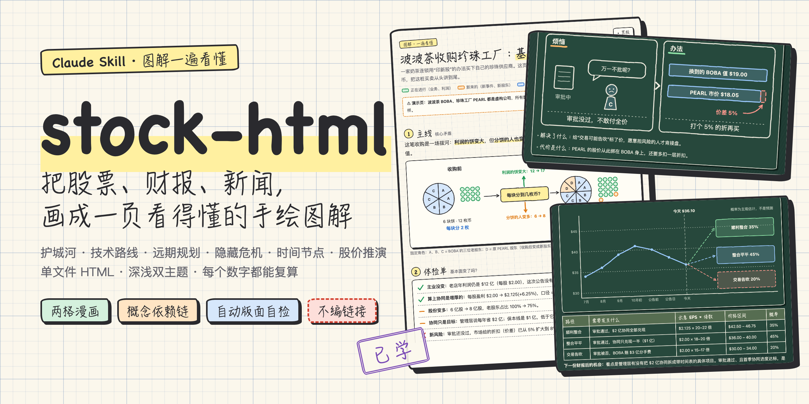</a>
</p>

<h1 align="center">stock-html</h1>

<p align="center">
  <b>Turn a stock, an earnings report or a headline into a hand-drawn page you understand in one read.</b><br>
  A Claude Skill. Moat, tech roadmap, long-term plan, hidden risks, key dates and price scenarios — all in one file.
</p>

<p align="center">
  <a href="https://stevensun1005.github.io/stock-html/"><b>🖍 Live demo</b></a> ·
  <a href="#-install">Install</a> ·
  <a href="#-usage">Usage</a> ·
  <a href="#-whats-in-a-report">Report structure</a> ·
  <a href="README.md">中文</a>
</p>

<p align="center">
  
  
  
  
  
</p>

---

## What it is

Hand Claude a ticker, an earnings PDF, a news link or a screenshot of a chart and say "explain this visually".

Instead of a wall of text you get **one HTML file**: graph-paper background, wobbly hand-drawn lines, and the same small cast of characters acting out every idea. Each concept is a two-panel comic — the pain without it on the left, the fix on the right — followed by exactly two lines: **what it solves, and what it costs**.

Every number on the page traces back to a formula in the build script. Every outbound link was actually opened and checked. Whether any text overlaps or runs into a border is tested by a script and a headless browser, not by hope.

| Graph paper (light) | Chalkboard (dark) |
|:---:|:---:|
| 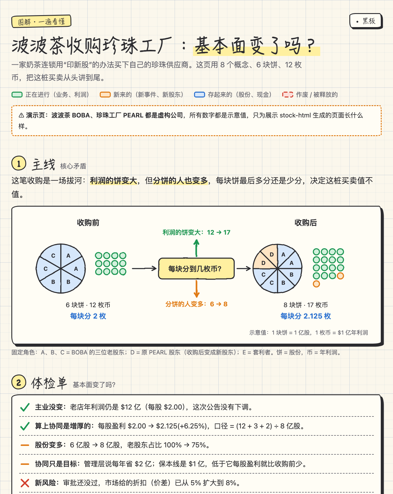 | 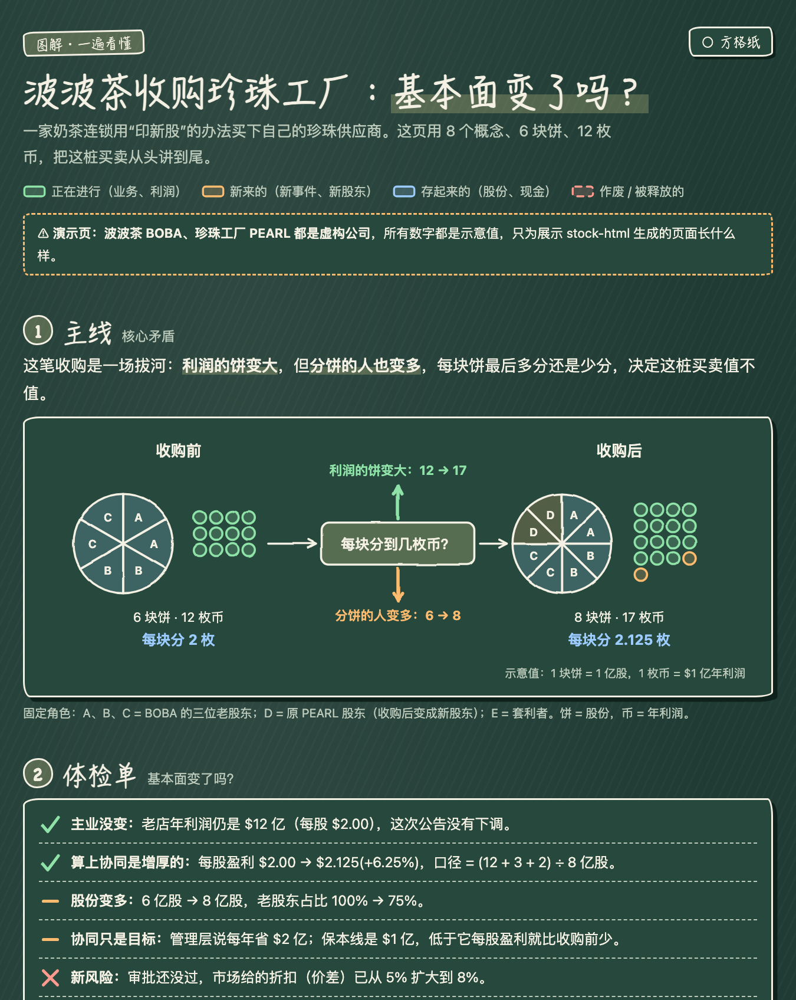 |

> The demo uses a **fictional** company (a bubble-tea chain buying its tapioca supplier) and is written in Chinese, the skill's default language. 👉 [Open the live demo](https://stevensun1005.github.io/stock-html/) — toggle the theme in the top-right corner and click the stamps on the cards.

## ✨ Why it is different

- **Ordered by dependency, not by table of contents.** 8–13 concepts form a chain: each one exists to fix the problem the previous one created. If a concept cannot say what it fixes, the order is wrong.
- **Every concept has a cost.** A card gets two lines only. "Basically no downside" fails the check.
- **No numbers from memory.** Inputs and derived values live at the top of the build script and are cross-checked with assertions before anything is drawn. Derived values are labelled "illustrative"; probabilities are labelled "subjective, not a forecast".
- **No invented links.** Every link in the learning route must be fetched and verified, or it is replaced with "search for it yourself".
- **Three layers of QA.** An offline pre-check (estimated text widths), a real render in headless Chrome (`getBBox` on every text node, both themes), then sliced screenshots for a human-style review.
- **One file that opens anywhere.** All CSS, JS and SVG are inline. No external requests, no dependencies. Works offline, as a published Artifact, or as an email attachment.
- **Two themes and progress stamps.** Each card has a stamp that cycles Next → Review → Done and is remembered by the browser.

<table>
<tr>
<td width="50%">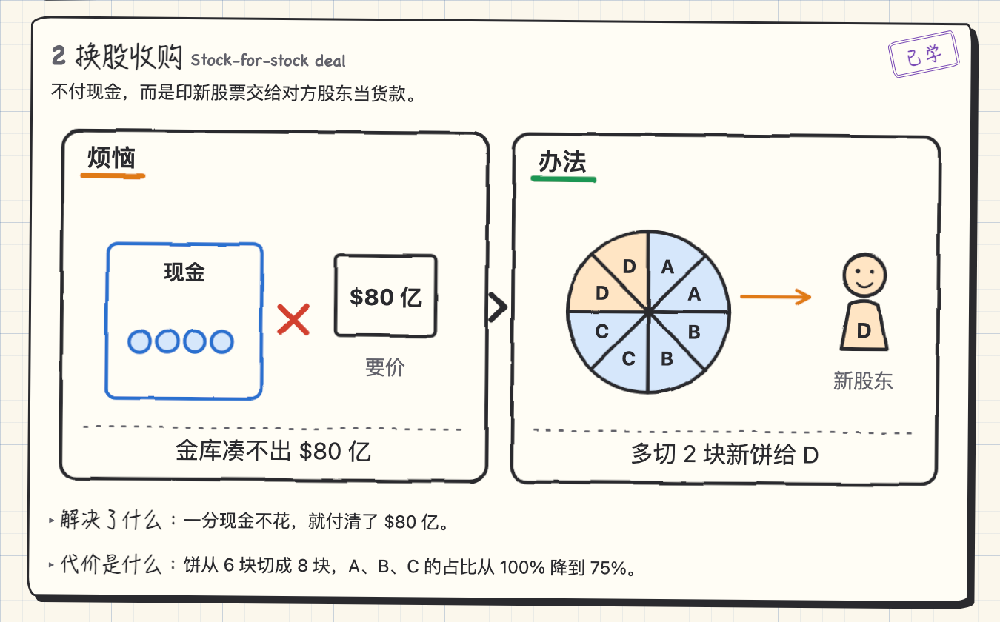</td>
<td width="50%">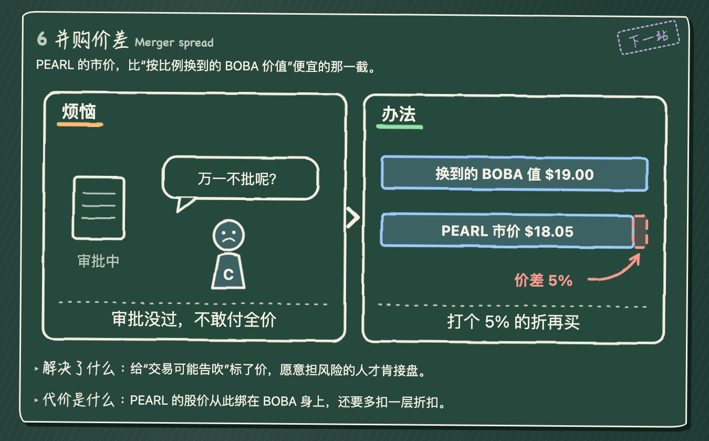</td>
</tr>
</table>

## 📋 What's in a report

A stock report includes **all of the following by default** (the build warns if one is missing). More sections are added when the material calls for them: peer valuation, management and capital allocation, cash flow and debt, customer concentration.

| # | Section | The question it answers | Looks like |
|---|---|---|---|
| 1 | **Big picture** | What is actually going on here? | One sentence + one drawing |
| 2 | **Health check** | Did the fundamentals change? | ✓ / — / ✗, each line with a number and its basis |
| 3 | **Core moat** | Which 2–3 things are truly hard to copy? What is the evidence? Where is it weak? | Moat drawing + evidence tiles |
| 4 | **Concept chain** | Which ideas do I need, in what order? | Snake flow chart |
| 5 | **Concept cards** | What does each idea solve, and what does it cost? | 8–13 two-panel comics |
| 6 | **Tech roadmap** | What is shipped, what is scheduled, what is only a vision? | Three rising steps |
| 7 | **Long-term plan** | Where does management want to be in 3–5 years, and does the current pace get there? | Target vs. current pace |
| 8 | **Hidden risks** | What is not in the press release? Which metric will flash first? | Likelihood × damage matrix + warning-sign table |
| 9 | **Key dates** | Which days in the next 6–12 months bring answers? Which dates are unconfirmed? | Timeline + calendar table |
| 10 | **Price scenarios** | What must happen on each of 2–3 paths, where do they land, how likely? | Forking paths with price bands |
| 11 | **The ruler** | Which metrics measure "good", and what does each move trade off? | EPS × P/E iso-price chart |
| 12 | **From zero** | The single most counter-intuitive mechanism, step by step | Waterfall + worked arithmetic + comparison table |
| 13 | **Learning route** | Where to go next, and for how long? | Metro map |

<table>
<tr>
<td width="50%"><b>Core moat</b><br>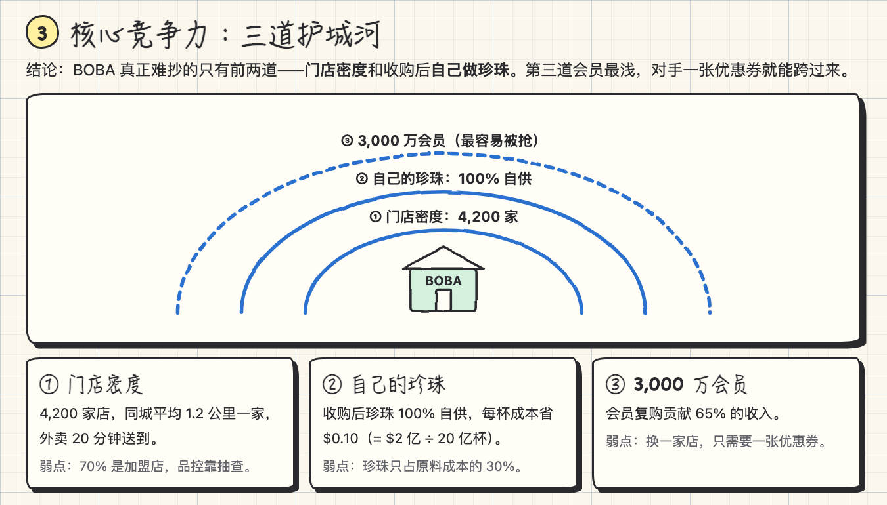</td>
<td width="50%"><b>Tech roadmap</b><br>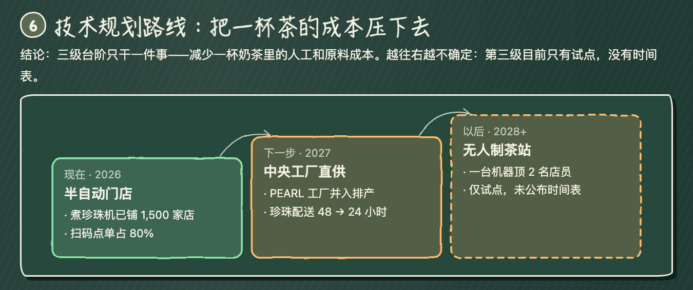</td>
</tr>
<tr>
<td><b>Hidden risks</b><br>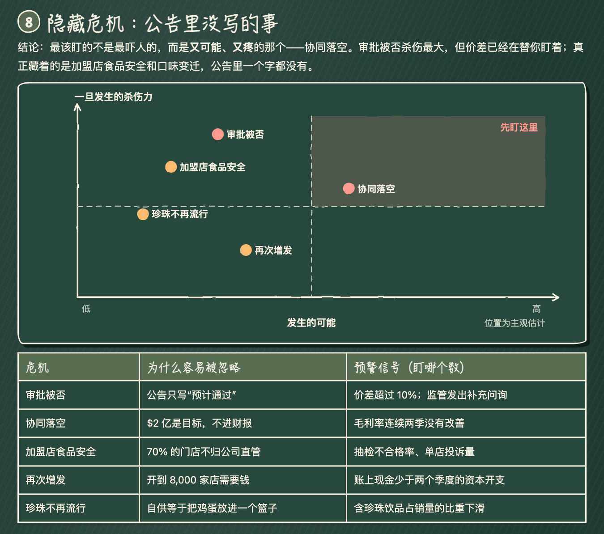</td>
<td><b>Key dates</b><br>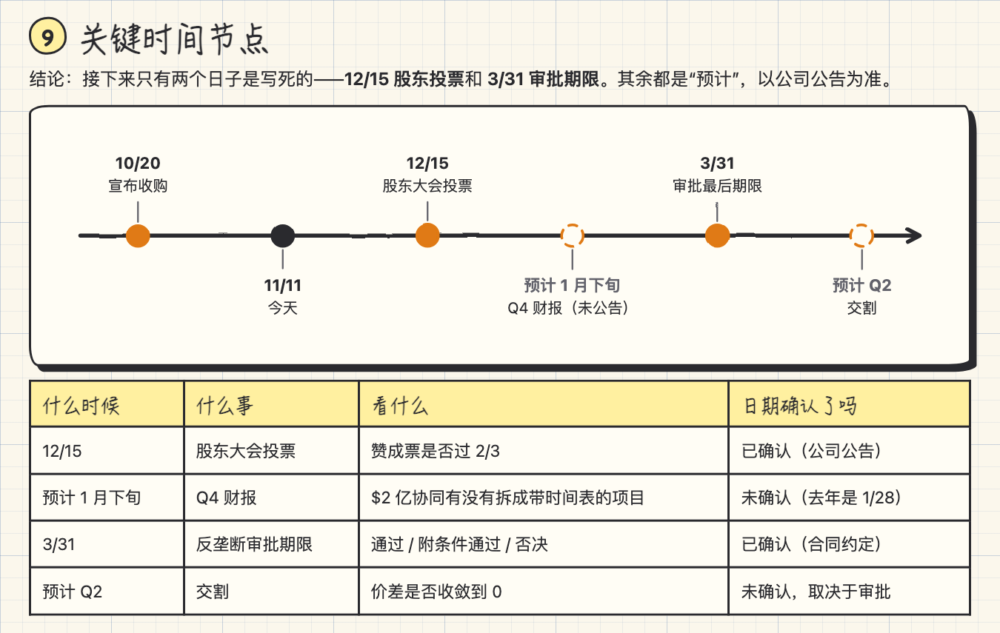</td>
</tr>
<tr>
<td><b>Long-term plan</b><br>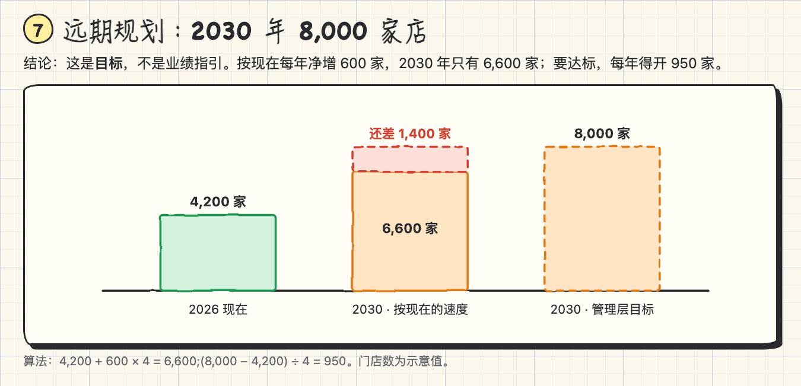</td>
<td><b>Price scenarios</b><br>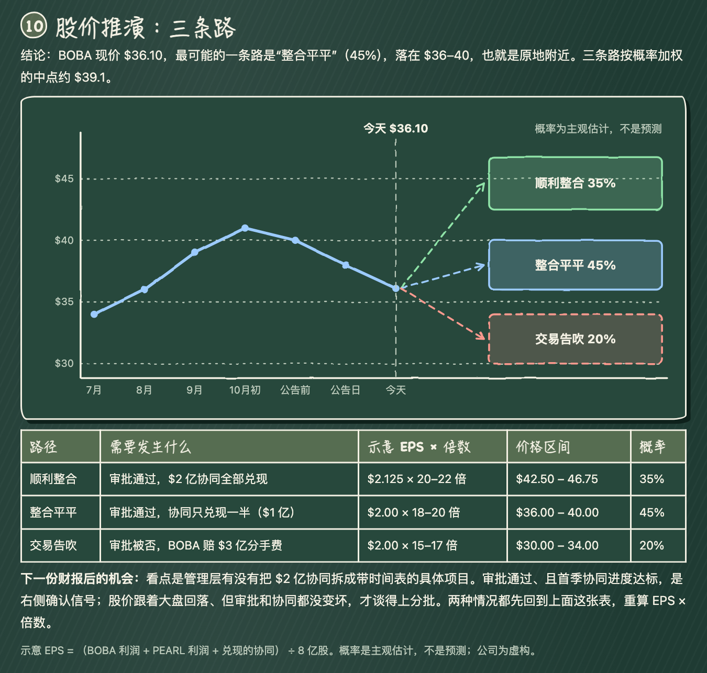</td>
</tr>
</table>

It is not only for stocks: articles, papers, technical docs and course notes use the general layout (big picture, concept chain, comic cards, ruler, learning route).

## 📦 Install

**Option 1 · Claude Code plugin (recommended)**

Run these inside Claude Code:

```
/plugin marketplace add stevensun1005/stock-html
```

```
/plugin install stock-html@stock-html
```

**Option 2 · Copy into your skills folder**

```bash
git clone https://github.com/stevensun1005/stock-html.git && mkdir -p ~/.claude/skills && cp -r stock-html/skills/stock-html ~/.claude/skills/
```

**Option 3 · claude.ai / Claude desktop**

Download `stock-html.zip` from [Releases](https://github.com/stevensun1005/stock-html/releases/latest) and upload it under Settings → Capabilities → Skills.

> Requires Python 3.8+ (standard library only). The real-render check uses a local Chrome, Chromium or Edge; without one the skill still works, minus that layer of automatic checking.

## 🚀 Usage

Just ask:

```
Explain NVDA's latest earnings visually. Did the fundamentals change?
```

```
I don't understand this merger news. Make an illustrated explainer page: <link>
```

```
ELI5 this paper (attached) as a visual study page, in English
```

You get a direct 2–3 sentence answer, the HTML file (or a published Artifact), a short tour of the page, and the full source list.

Pages are written in Chinese by default. Ask for English and the skill switches labels, comic headers and caption limits (`set_lang("en")`).

## 🛠 Try it without Claude

Build the bundled example:

```bash
python3 skills/stock-html/examples/boba_merger.py demo.html
```

Render it for real and take screenshots:

```bash
python3 skills/stock-html/scripts/verify.py demo.html --shots shots/
```

```
[CHECK light] PASS
[CHECK dark] PASS
svg: 19   page height: 12236px
```

`sketch.py` also works on its own as a tiny hand-drawn diagram toolkit:

```python
import sys; sys.path.insert(0, "skills/stock-html/scripts")
from sketch import *

set_lang("en")
k = Comic("The vault is $80B short", "Cut 2 new slices for D")   # captions ≤ 32 chars
k.rect(36, 78, 96, 96, "blue").coins(50, 132, 4, "blue", cols=4)
k.pie(372, 118, 50, ["blue"] * 6 + ["orange"] * 2).person(506, 80, "D", "orange", "happy")

p = Page("What is a stock-for-stock deal?", kind="general")
p.chain([("Stock deal", "dilutes old holders")])
p.card("Stock deal", "Stock-for-stock", "Pay with newly issued shares instead of cash.", k,
       "The price is paid without spending cash.", "The pie is cut into more slices; old holders own less.")
p.save("page.html")          # writes the file and runs the pre-check (it will note the missing sections)
```

## ⚙️ How it works

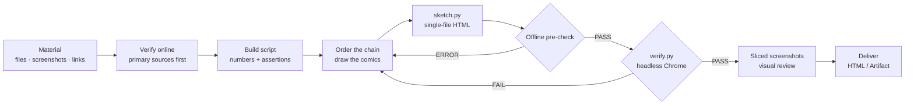

```
stock-html/
├── skills/stock-html/          ← the skill itself (this folder is all you need)
│   ├── SKILL.md                    workflow, report structure, hard rules
│   ├── scripts/sketch.py           toolkit: canvas, comics, charts, page builder, pre-check
│   ├── scripts/blocks.py           ready-made blocks: mainline, moat, vision chart, 3 comic layouts (for batches)
│   ├── scripts/verify.py           headless-Chrome check + sliced screenshots
│   ├── assets/template.html        page template: themes, wobble filter, stamps, self-check
│   ├── examples/boba_merger.py     full worked example (builds the live demo)
│   └── references/                 how to write each section · visual style · QA guide
├── docs/                       ← live demo and images
├── .claude-plugin/             ← Claude Code plugin / marketplace manifests
└── tools/package.sh            ← builds the zip for claude.ai
```

## ❓ FAQ

**Why is the demo a fictional company?** A public repo is the wrong place for an "analysis" of a real stock: the numbers go stale and it can be mistaken for advice. A fictional company lets every figure reconcile exactly, which makes the build script a clean reference. In real use the skill researches and verifies real data.

**Will it tell me to buy or sell?** No. It lays out fundamentals, risks, dates and scenarios. Every price level is a worked example of "illustrative EPS × multiple", every probability is labelled subjective, and the footer always carries "for learning only, not investment advice".

**No Chrome on this machine?** `verify.py` tells you the fallback: open `page.html?check=1` in any browser and look for the green PASS bar at the bottom.

**Can I restyle it?** Yes. Colours, fonts and radii are CSS variables in `assets/template.html`; the charts are plain functions in `sketch.py`.

## ⚠️ Disclaimer

Everything this project generates is **for learning only and is not investment advice**. Price levels and probabilities are illustrative and subjective. You are responsible for your own decisions; always defer to company filings and regulatory documents.

## 🤝 Contributing

Issues and PRs are welcome: new chart types, new examples, more languages, better-looking stick figures. Before opening a PR, run:

```bash
python3 skills/stock-html/examples/boba_merger.py docs/index.html && python3 skills/stock-html/scripts/verify.py docs/index.html
```

## 📄 License

[MIT](LICENSE)

---

<p align="center">If a page helped something click, a ⭐ helps other people find it.</p>
