<p align="center">
  <a href="https://stevensun1005.github.io/stock-html/">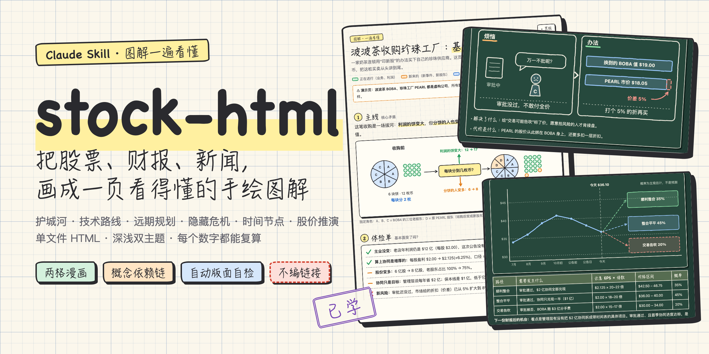</a>
</p>

<h1 align="center">stock-html</h1>

<p align="center">
  <b>把一只股票、一份财报、一条重大新闻，画成一页"看一遍就懂"的手绘图解。</b><br>
  一个 Claude Skill：护城河、技术路线、远期规划、隐藏危机、关键时间节点、股价推演，一次给齐。
</p>

<p align="center">
  <a href="https://stevensun1005.github.io/stock-html/"><b>🖍 在线示例</b></a> ·
  <a href="#-安装">安装</a> ·
  <a href="#-怎么用">怎么用</a> ·
  <a href="#-一份报告里默认有什么">报告结构</a> ·
  <a href="README.en.md">English</a>
</p>

<p align="center">
  
  
  
  
  
</p>

---

## 这是什么

你把股票代码、财报 PDF、新闻链接或者一张行情截图丢给 Claude，说一句"**图解一下**"。

它不会回你一篇三千字的长文，而是交给你**一个 HTML 文件**：方格纸底色，手绘线条，固定的几个小人从头演到尾。每个概念一幅两格漫画——左边是"没有它时的烦恼"，右边是"它的办法"——下面只有两行字：**解决了什么，代价是什么**。

页面里的每个数字都能在生成脚本里找到算式；每条外链都被真的打开核实过；文字有没有压线、重叠，由脚本和无头浏览器替你查。

| 方格纸（浅色） | 黑板（深色） |
|:---:|:---:|
| 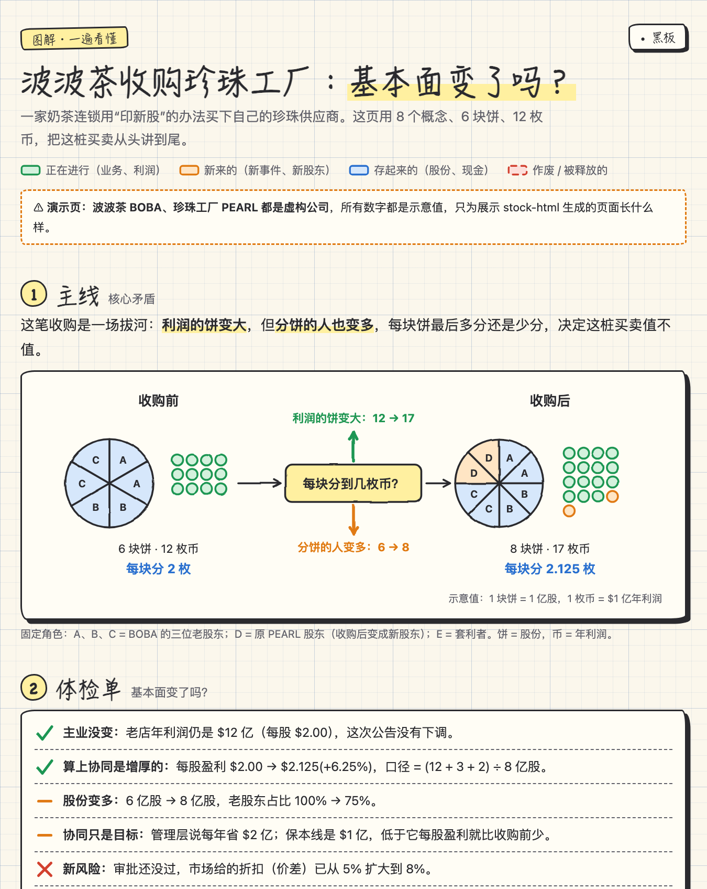 | 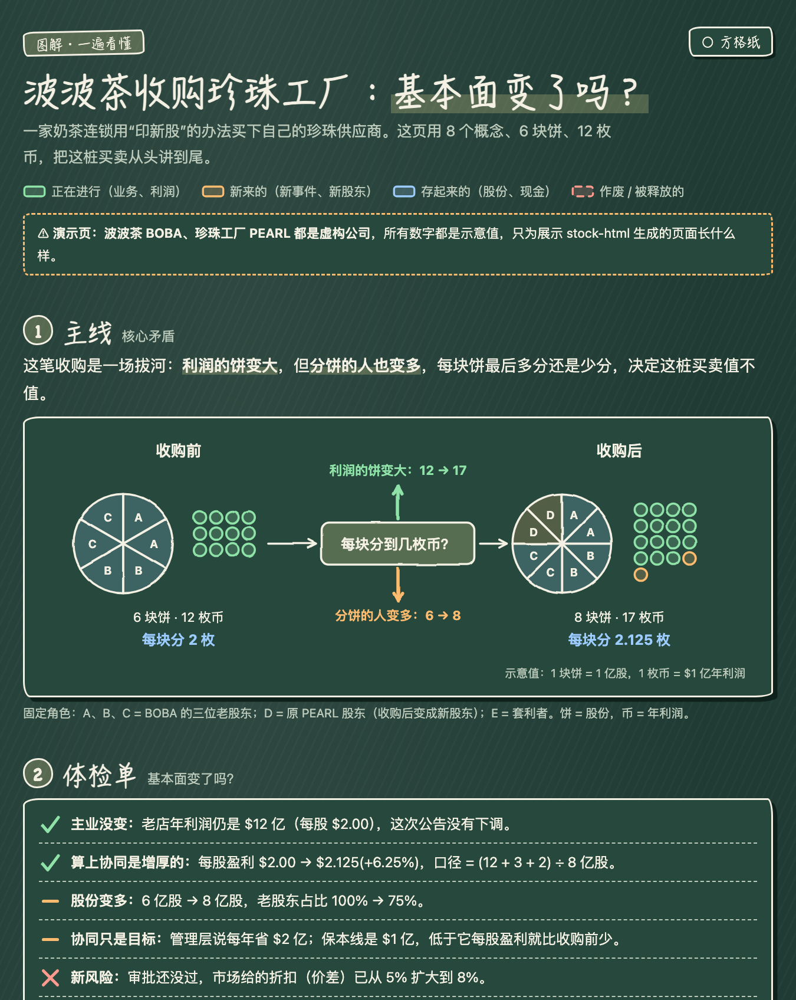 |

> 上面是仓库自带的示例页，公司是**虚构**的（波波茶 BOBA 收购珍珠工厂 PEARL），只为演示页面长什么样。 👉 [打开在线示例](https://stevensun1005.github.io/stock-html/)，右上角可以切主题，卡片上的印章可以点。

## ✨ 为什么不一样

- **按依赖讲，不按目录讲。** 8–13 个概念排成一条链：后一个概念，是为了解决前一个概念带来的问题。说不出"它在解决什么"，就是排错了。
- **每个概念都有代价。** 卡片只许写两行——解决了什么、代价是什么。"基本没有代价"过不了检查。
- **数字不靠印象。** 所有数字先写进生成脚本、用断言互相对账，算不平不许画图。推算值标"示意"，概率标"主观估计，不是预测"。
- **不编链接。** 学习路线里的每个链接都要打开核实；核实不了就老老实实写"需自行搜索"。
- **三层自检。** 离线预检（估算字宽）→ 无头 Chrome 真实渲染(`getBBox` 量每一段文字)→ 分段截图人眼复核。文字压线、重叠的页面发不出去。
- **一个文件，到处能开。** CSS、JS、SVG 全部内联，零外链、零依赖；离线能看，能当 Artifact 发布，能直接发给朋友。
- **两套主题 + 学习进度。** 方格纸 / 黑板一键切换；每张卡片右上角的印章点一下就在"下一站 → 补一下 → 已学"之间切换，浏览器会记住。

<table>
<tr>
<td width="50%">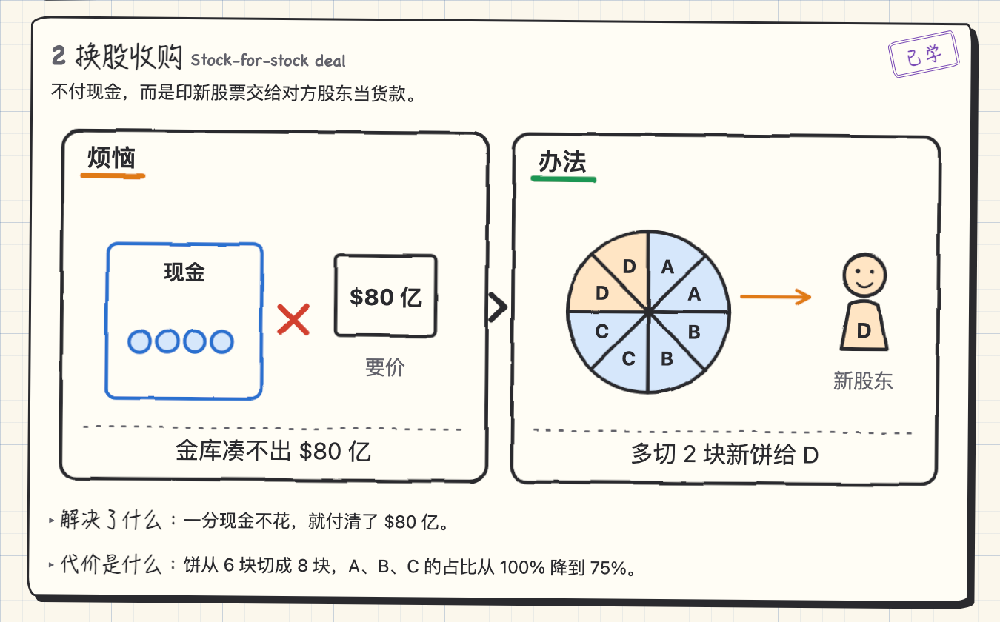</td>
<td width="50%">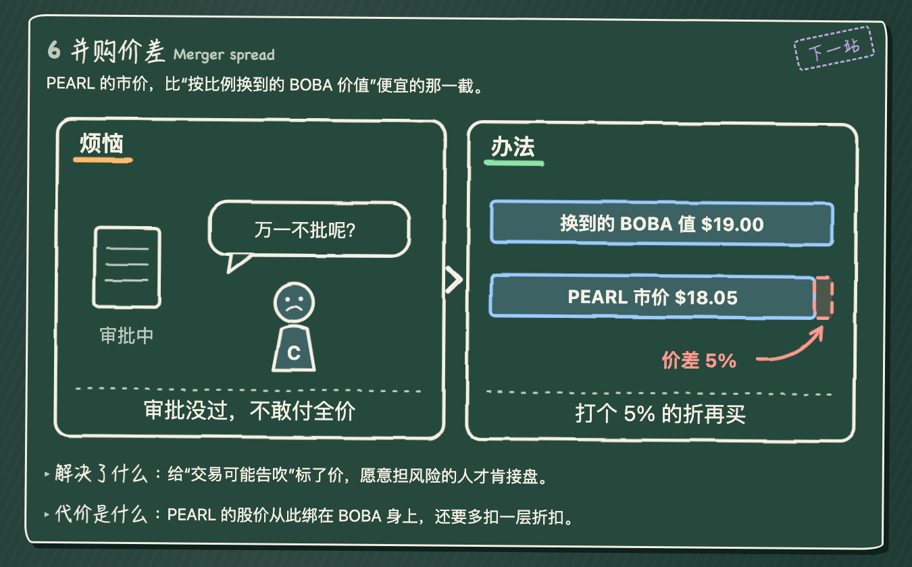</td>
</tr>
<tr>
<td colspan="2">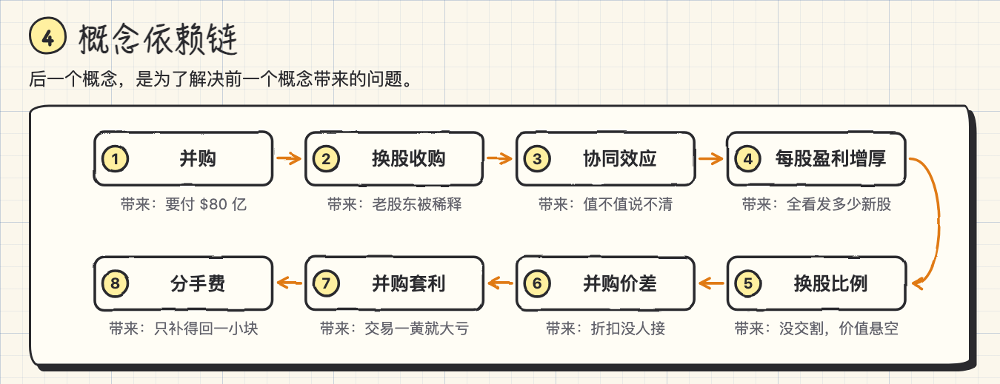</td>
</tr>
</table>

## 📋 一份报告里默认有什么

股票类报告**默认包含下面每一节**（缺了会报警），材料里有别的重点再往上加——估值与同行对比、管理层与资本配置、现金流与负债、客户集中度……

| # | 小节 | 回答什么问题 | 长什么样 |
|---|---|---|---|
| 1 | **主线** | 这件事到底在干什么？ | 一句话 + 一张图 |
| 2 | **体检单** | 基本面变了吗？ | ✓ / — / ✗，每行带数字和口径 |
| 3 | **核心竞争力** | 哪 2–3 件事别人真的抄不走？证据是哪个数？弱点在哪？ | 护城河图 + 证据卡 |
| 4 | **概念依赖链** | 看懂它要先懂哪些概念？ | 蛇形流程图 |
| 5 | **概念卡片** | 每个概念解决了什么、代价是什么？ | 两格漫画 × 8–13 |
| 6 | **技术规划路线** | 现在做到哪、下一步是什么、哪些只是愿景？ | 三级台阶 |
| 7 | **远期规划** | 管理层 3–5 年要去哪？按现在的速度到得了吗？ | 目标 vs 现速 |
| 8 | **隐藏危机** | 公告里没写的是什么？盯哪个数会亮灯？ | 可能性 × 杀伤力 四象限 + 预警表 |
| 9 | **关键时间节点** | 未来 6–12 个月哪几天出结果？哪些日期还没确认？ | 时间轴 + 日程表 |
| 10 | **股价推演** | 2–3 条路各需要发生什么、落在哪、概率多少？ | 分叉路径 + 价格色带 |
| 11 | **尺子** | 衡量好坏的指标是什么？每个办法改善哪个、牺牲哪个？ | EPS × P/E 等价线 |
| 12 | **零基础版** | 最反直觉的那个机制，一步步怎么算？ | 瀑布图 + 算式 + 对比表 |
| 13 | **学习路线** | 接下来去哪学？多久？ | 地铁线路图 |

<table>
<tr>
<td width="50%"><b>核心竞争力</b><br>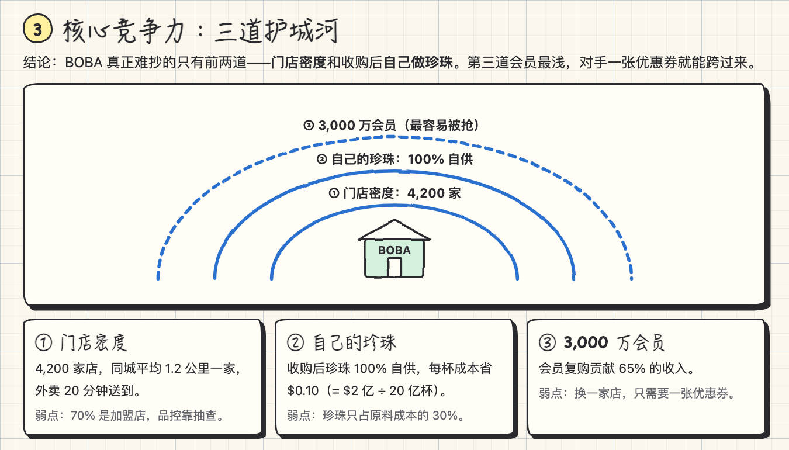</td>
<td width="50%"><b>技术规划路线</b><br>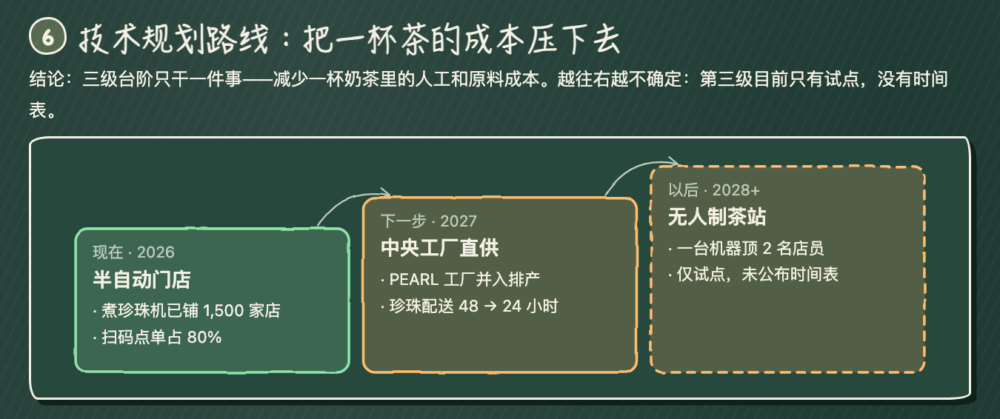</td>
</tr>
<tr>
<td><b>远期规划</b><br>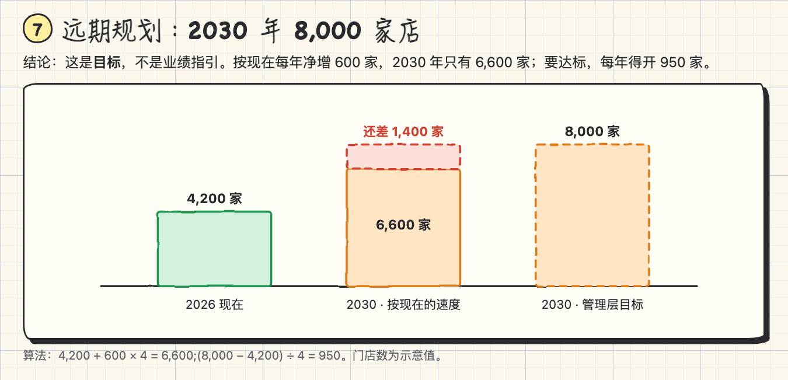</td>
<td><b>隐藏危机</b><br>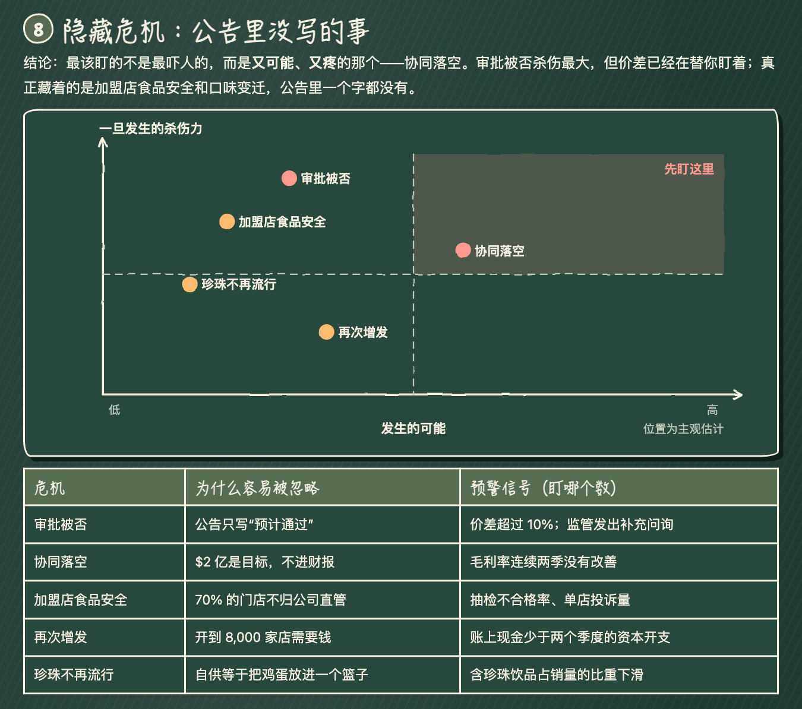</td>
</tr>
<tr>
<td><b>关键时间节点</b><br>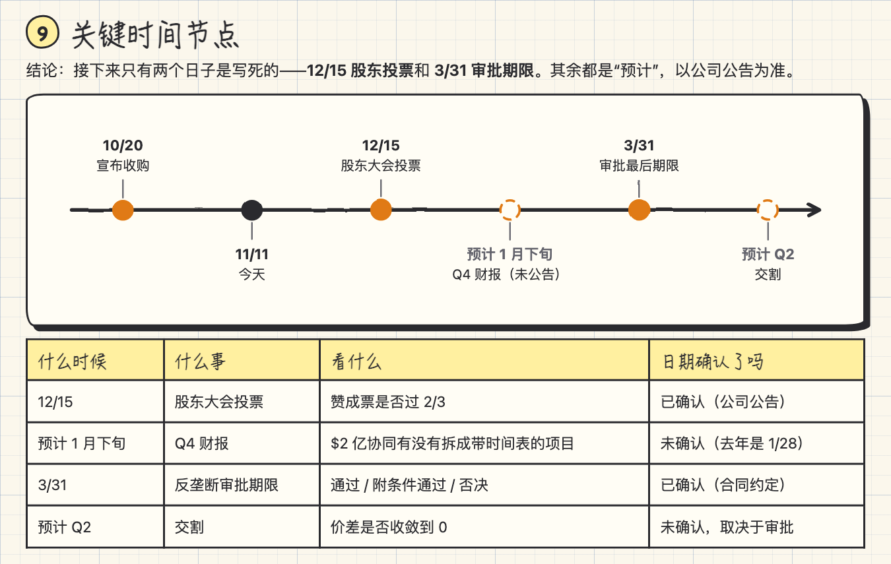</td>
<td><b>股价推演</b><br>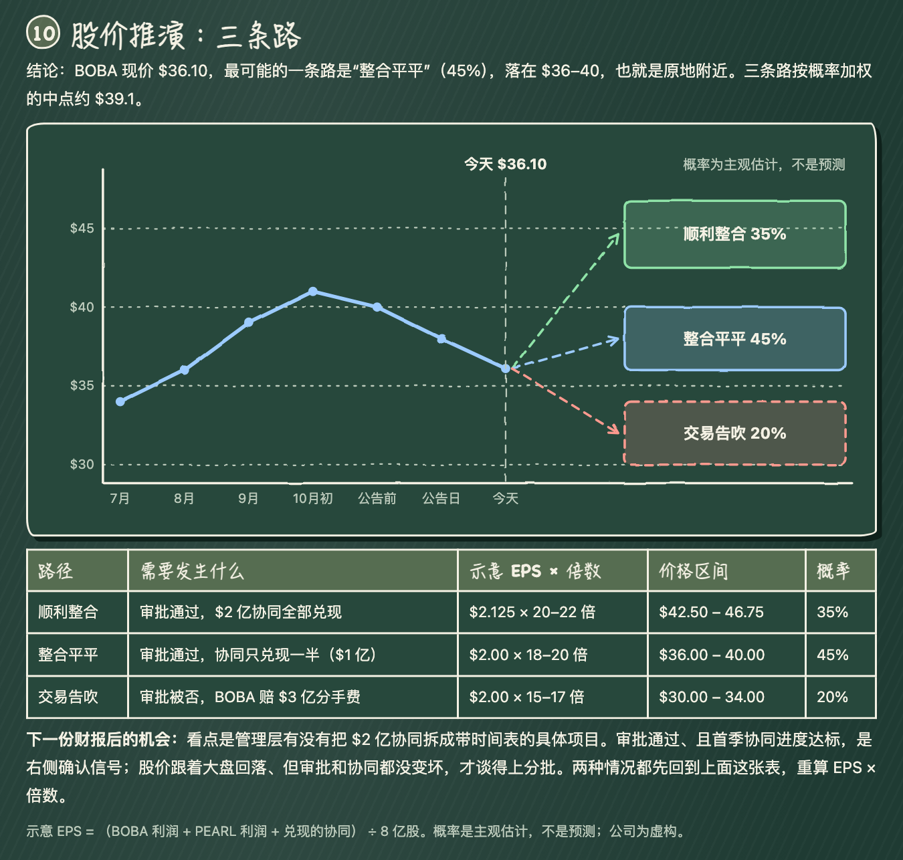</td>
</tr>
</table>

不是股票也能用：文章、论文、技术文档、课程笔记会走"通用学习页"——主线、依赖链、漫画卡片、尺子、学习路线。

## 📦 安装

**方式一 · Claude Code 插件（推荐）**

在 Claude Code 里依次输入：

```
/plugin marketplace add stevensun1005/stock-html
```

```
/plugin install stock-html@stock-html
```

**方式二 · 手动放进 skills 目录**

```bash
git clone https://github.com/stevensun1005/stock-html.git && mkdir -p ~/.claude/skills && cp -r stock-html/skills/stock-html ~/.claude/skills/
```

**方式三 · claude.ai / Claude 桌面版**

到 [Releases](https://github.com/stevensun1005/stock-html/releases/latest) 下载 `stock-html.zip`，在"设置 → 功能 → Skills"里上传。

> 需要 Python 3.8+（只用标准库）。真实渲染检查会用到本机的 Chrome / Chromium / Edge；没有也能用，只是少一层自动检查。

## 🚀 怎么用

装好之后直接说人话：

```
图解一下 NVDA 最新这份财报,基本面变了吗?
```

```
这条并购新闻我看不懂,帮我做成图解页面:<链接>
```

```
零基础讲讲这家公司的护城河、隐藏风险和接下来的关键时间点
```

```
ELI5 这篇论文(附件),做成可视化学习页
```

你会得到：2–3 句直接回答你的问题 → 一个 HTML 文件（或发布好的 Artifact）→ 页面结构说明 → 全部来源。

## 🛠 不装 Claude 也能先玩

仓库自带一份完整的示例生成脚本，一条命令出页面：

```bash
python3 skills/stock-html/examples/boba_merger.py demo.html
```

再跑一遍真实渲染检查并截图：

```bash
python3 skills/stock-html/scripts/verify.py demo.html --shots shots/
```

```
[CHECK light] PASS
[CHECK dark] PASS
svg: 19   page height: 12236px
```

工具箱 `sketch.py` 可以单独拿来画手绘风的图：

```python
import sys; sys.path.insert(0, "skills/stock-html/scripts")
from sketch import *

k = Comic("金库凑不出 $80 亿", "多切 2 块新饼给 D")        # 两格漫画,说明 ≤ 15 字
k.rect(36, 78, 96, 96, "blue").coins(50, 132, 4, "blue", cols=4)
k.pie(372, 118, 50, ["blue"] * 6 + ["orange"] * 2).person(506, 80, "D", "orange", "happy")

p = Page("换股收购是什么", kind="general")
p.chain([("换股收购", "老股东被稀释")])
p.card("换股收购", "Stock-for-stock deal", "不付现金,印新股当货款。", k,
       "一分现金不花就付清了对价。", "饼被切成更多块,老股东占比下降。")
p.save("page.html")          # 写文件 + 自动预检（会提醒这页还缺主线和学习路线）
```

## ⚙️ 它是怎么工作的

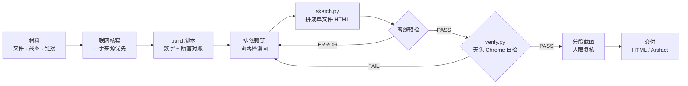

```
stock-html/
├── skills/stock-html/          ← skill 本体(装这个目录就够了)
│   ├── SKILL.md                    工作流程、报告结构、硬性要求
│   ├── scripts/sketch.py           手绘图解工具箱:画布、漫画、图表、页面、离线预检
│   ├── scripts/blocks.py           半成品积木:主线图、护城河、远期对账、三种漫画版式(批量做报告用)
│   ├── scripts/verify.py           无头 Chrome 自检 + 分段截图
│   ├── assets/template.html        页面模板:双主题、抖动滤镜、印章、内置自检
│   ├── examples/boba_merger.py     完整示例(本仓库在线示例的生成脚本)
│   └── references/                 每一节怎么写 · 视觉规范 · 自检手册
├── docs/                       ← 在线示例与配图
├── .claude-plugin/             ← Claude Code 插件 / 市场清单
└── tools/package.sh            ← 打包 claude.ai 用的 zip
```

## ❓ 常见问题

**示例为什么用虚构公司？** 公开仓库里放一份对真实股票的"分析"不合适：数字会过期，也容易被当成建议。虚构公司能把每个数都设计成算得平，方便你对着脚本学写法。你自己用的时候，它会去核实真实数据。

**它会告诉我买还是卖吗？** 不会。它只分析股票本身：把基本面、风险、时间表和几条路径摆清楚，所有价位都是"示意 EPS × 倍数"推出来的方法演示，概率都标"主观估计"。页脚固定有"仅作学习用途，不构成投资建议"。

**支持英文页面吗？** 支持，`set_lang("en")` 之后界面文字、漫画表头和字数限制都会切到英文。

**没有 Chrome 怎么办？** `verify.py` 会提示备用办法：在任意浏览器打开 `页面.html?check=1`，底部会出现检查条，绿色 PASS 即可。

**能改风格吗？** 能。颜色、字体、圆角都是 `assets/template.html` 里的 CSS 变量；图表都是 `sketch.py` 里的普通函数，照着加就行。

## ⚠️ 免责声明

本项目生成的所有内容**仅作学习用途，不构成投资建议**。页面中的价位、概率均为示意与主观估计；据此操作的风险由使用者自行承担。请始终以公司公告和监管文件为准。

## 🤝 参与

欢迎提 Issue 和 PR：新的图表类型、新的示例、别的语言、更好看的小人。改完请跑一遍：

```bash
python3 skills/stock-html/examples/boba_merger.py docs/index.html && python3 skills/stock-html/scripts/verify.py docs/index.html
```

## 📄 License

[MIT](LICENSE)

---

<p align="center">如果这页图解帮你看懂了一件事，点个 ⭐ 让更多人看到。</p>
